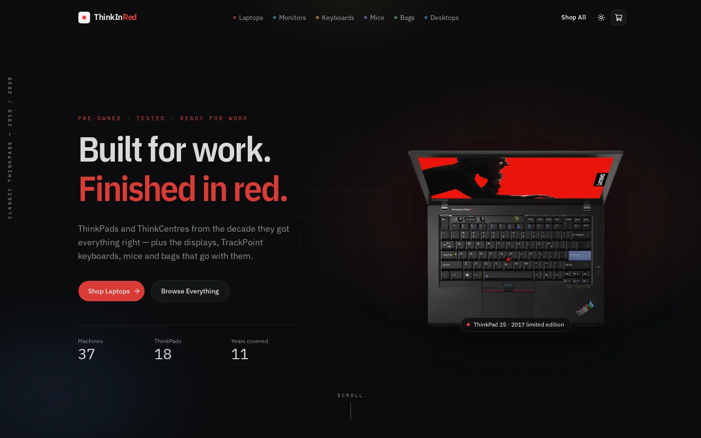
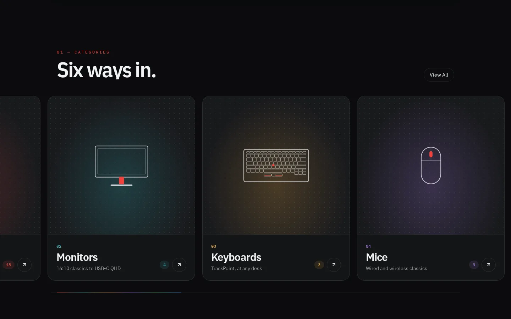
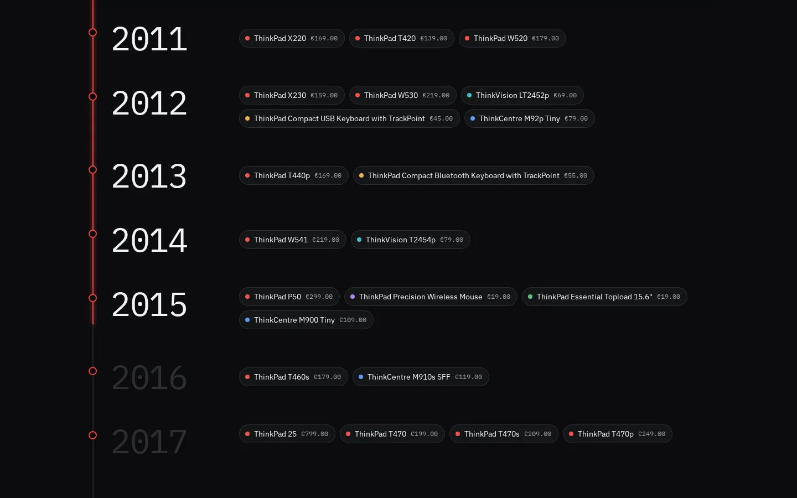
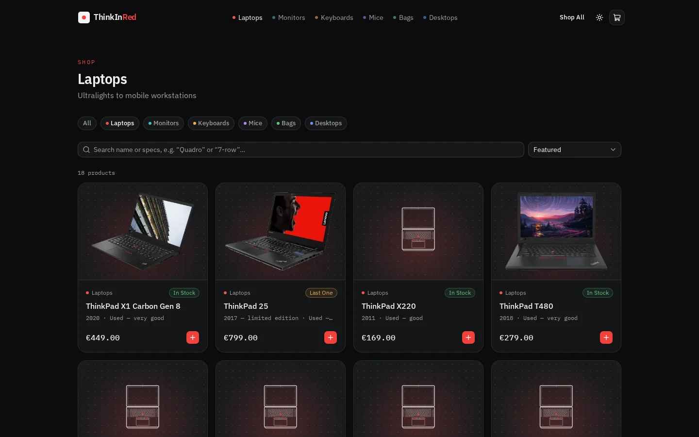
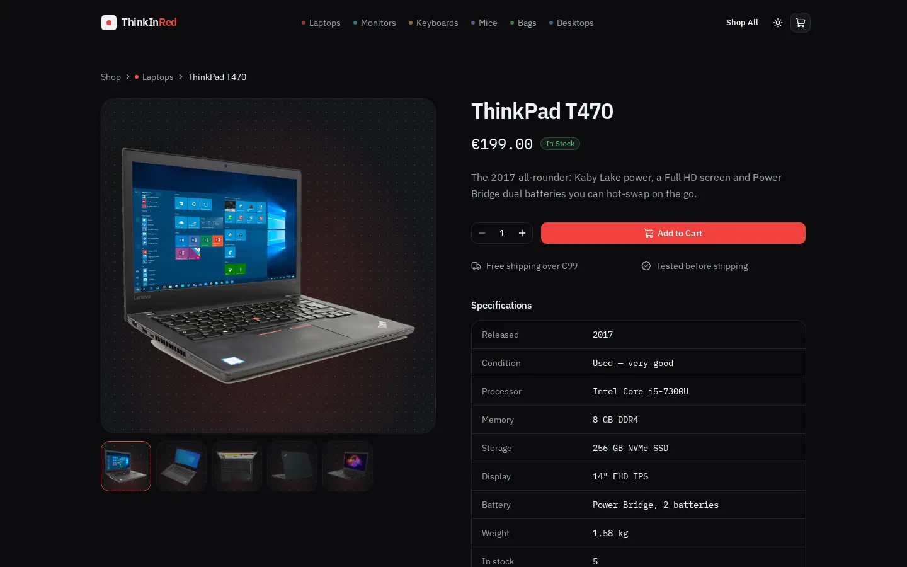
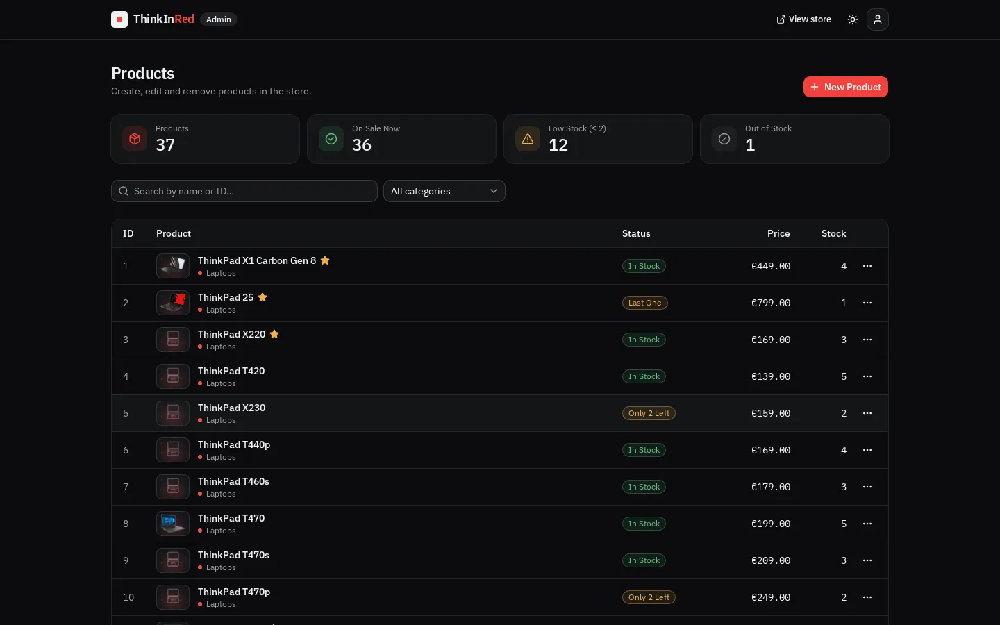
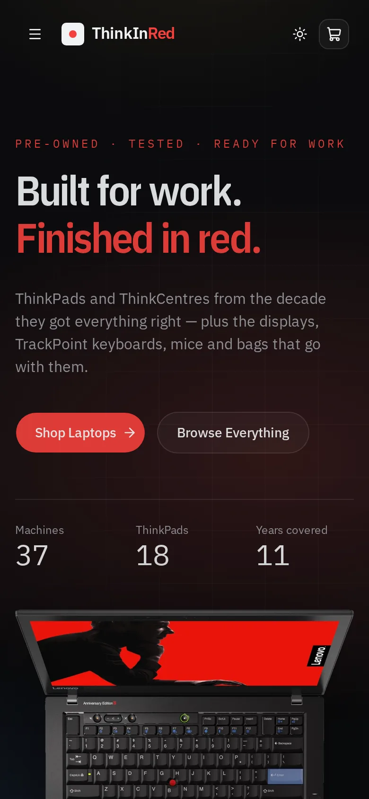

# ThinkInRed

**A storefront for pre-owned ThinkPad and ThinkCentre gear from 2010–2020.**
It's a full-stack portfolio project: a NestJS + PostgreSQL API, and a React storefront with an admin panel and scroll-driven animation.



> ThinkInRed is a portfolio project, not a real shop. It is not affiliated with or endorsed by Lenovo.
> Prices are estimates of typical used prices on eBay.de, and specs are illustrative.

---

## Contents

- [Features](#features)
- [Screenshots](#screenshots)
- [Tech stack](#tech-stack)
- [Project structure](#project-structure)
- [Getting started](#getting-started)
- [Scripts](#scripts)
- [API](#api)
- [Deployment](#deployment)
- [Credits & legal](#credits--legal)

## Features

**Storefront**
- **Scroll-story home page:**
  - a hero headline that animates in letter by letter;
  - a ticker of model names;
  - a pinned section where scrolling moves the category cards sideways;
  - a fixed product spotlight whose specs reveal as you scroll;
  - a 2010–2020 timeline built from the catalog;
  - a closing wordmark that fills with red as you scroll.
- **Catalog:** six categories (Laptops, Desktops, Monitors, Keyboards, Mice, Bags), each with its own accent colour.
  - **Search** covers names and specs, for example "Quadro" or "7-row".
  - **Filters and sorting** are kept in the URL, so filtered views can be shared.
- **Product pages:** a photo gallery, a spec sheet, stock status, and related products.
- **Cart:** stored in the browser, with an undo for destructive actions.
- **Themes and layout:** dark theme by default with a light theme, and a responsive layout down to phone widths.

**Admin panel** (`/admin`)
- **Sign-in:** JWT-based admin login.
- **Product list:** stats, search and a category filter.
- **Product form:** a create/edit form validated with Zod, with:
  - a date picker for the sale period;
  - image and gallery URL fields with a live preview;
  - a spec-sheet editor whose rows can be reordered;
  - a "featured" toggle.
- **Delete:** soft delete with a confirmation dialog.

**Quality details**
- **Reduced motion:** honours `prefers-reduced-motion`. Smooth scrolling, the ticker and all movement turn off, and only fades remain.
- **Keyboard access:** a skip link, visible focus rings and labelled icon buttons.
- **Validation:** applied on both sides, with Zod in the browser and `class-validator` DTOs in the API.
- **Code splitting:** the admin pages load only when opened, so shoppers never download them.

## Screenshots

| Categories (pinned, horizontal scroll) | The decade timeline |
| --- | --- |
|  |  |

| Shop | Product page with gallery |
| --- | --- |
|  |  |

| Admin panel | Mobile |
| --- | --- |
|  |  |

## Tech stack

| Area | Tools |
| --- | --- |
| Frontend | React 19, TypeScript, Vite, React Router, TanStack Query |
| UI | Tailwind CSS v4, shadcn/ui (Radix), lucide-react, IBM Plex Sans & Mono |
| Motion | Motion (`motion/react`), Lenis smooth scroll, GSAP SplitText (React Bits) |
| Forms | react-hook-form + Zod |
| Backend | NestJS 11, TypeORM, class-validator, JWT auth, bcrypt |
| Database | PostgreSQL (migrations + a seed script for the demo catalog) |
| Testing | Jest unit tests (API) |

## Project structure

```
.
├── ecommerce-main/          # NestJS API
│   └── src/
│       ├── auth/            # login, JWT guard
│       ├── products/        # entity, DTOs, service, controller, categories
│       ├── migrations/      # schema + admin seed
│       └── seed/            # demo catalog (npm run seed)
├── frontend/                # React storefront + admin
│   ├── public/products/     # product photos (WebP)
│   └── src/
│       ├── components/home/ # scroll-story sections
│       ├── components/ui/   # shadcn/ui components
│       ├── lib/             # API client, auth, cart, categories, formatting
│       └── pages/           # routes
├── docs/screenshots/        # images used in this README
└── ecommerce.json           # Postman collection
```

## Getting started

**Prerequisites:** Node.js 22+, npm, and PostgreSQL 14+.

### 1. Database

```bash
createdb ecommerce   # default credentials: postgres / postgres
```

### 2. API

```bash
cd ecommerce-main
cp .env.example .env      # set JWT_SECRET (e.g. openssl rand -hex 32)
npm install
npm run start:dev         # http://localhost:3000, creates tables and seeds the admin
npm run seed              # in another terminal: loads the demo catalog (37 products)
```

### 3. Frontend

```bash
cd frontend
cp .env.example .env      # VITE_API_URL=http://localhost:3000
npm install
npm run dev               # http://localhost:5173
```

**Admin:** open <http://localhost:5173/admin> and sign in with `admin@example.com` / `admin123`.
These are local defaults only. Set `ADMIN_EMAIL` and `ADMIN_PASSWORD` before the first run in any shared environment.

## Scripts

| Where | Command | What it does |
| --- | --- | --- |
| `ecommerce-main` | `npm run start:dev` | API in watch mode |
| | `npm run migration:run` | Apply database migrations (use this in production) |
| | `npm run seed` | Load the demo catalog if the products table is empty |
| | `npm run seed -- --reset` | **Delete all products**, then reload the catalog |
| | `npm test` | Unit tests |
| `frontend` | `npm run dev` | Dev server |
| | `npm run build` | Typecheck + production build |
| | `npm run lint` | Lint (oxlint) |

## API

| Method | Path | Auth | Notes |
| --- | --- | --- | --- |
| `POST` | `/auth/login` | | `{ email, password }` → `{ access_token, admin }` |
| `GET` | `/products?category=laptops` | | `category` is optional |
| `GET` | `/products/:id` | | |
| `POST` | `/products` | JWT | Create |
| `PUT` | `/products/:id` | JWT | Partial update; `null` clears dates and images |
| `DELETE` | `/products/:id` | JWT | Soft delete |

**Products** have `name`, `category`, `description`, `price`, `currency`, `available_quantity`,
the sale dates `sold_from` and `sold_to`, `image_url`, `gallery[]`, `specs[{ label, value }]` and `featured`.

**Postman:** import `ecommerce.json`. Its Login request saves the token for the other requests.

For more detail, see [`ecommerce-main/README.md`](ecommerce-main/README.md) and [`frontend/README.md`](frontend/README.md).

## Deployment

The plan is to host both apps on **Vercel**, with **Neon** for PostgreSQL.

1. **Database:** create a Neon database and copy its `DATABASE_URL` (with `sslmode=require`).
2. **API (Vercel project, root `ecommerce-main`):** set these environment variables:
   - `NODE_ENV=production`
   - `DATABASE_URL`
   - `JWT_SECRET`
   - `CORS_ORIGIN`, set to the frontend URL
   - `ADMIN_EMAIL` and `ADMIN_PASSWORD`
3. **Schema and data:** run `npm run migration:run`, then `npm run seed`, against the Neon database.
4. **Frontend (Vercel project, root `frontend`):** set `VITE_API_URL` to the API URL.
   It's a single-page app, so all routes need to be rewritten to `index.html`.

## Credits & legal

- **Trademarks:** ThinkPad, ThinkCentre and ThinkVision are trademarks of Lenovo. Product photos are © Lenovo or their respective owners and are used here for non-commercial portfolio purposes only.
- **Prices:** estimates of typical used prices on eBay.de, not live data.
- **Third-party UI:** the SplitText component is from [React Bits](https://reactbits.dev).
  The UI is built with [shadcn/ui](https://ui.shadcn.com), with icons from [Lucide](https://lucide.dev).
